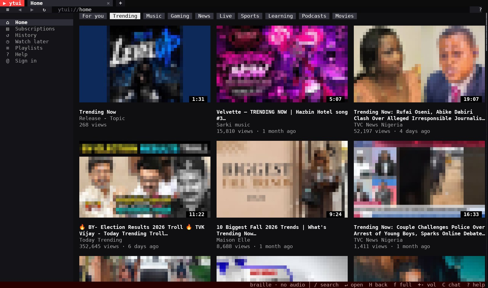
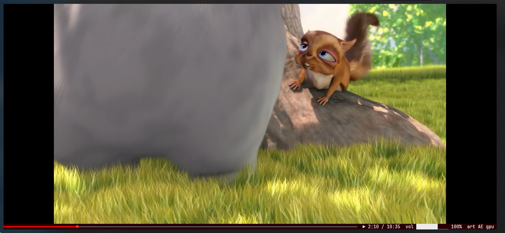
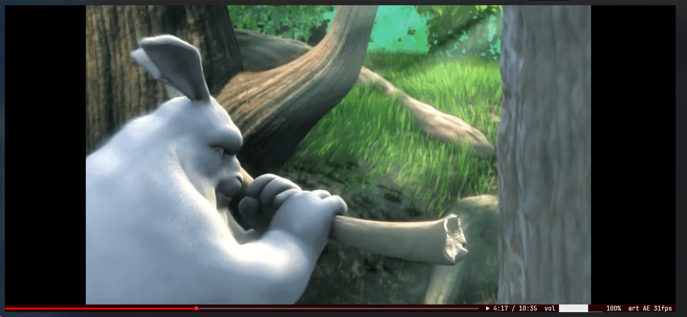
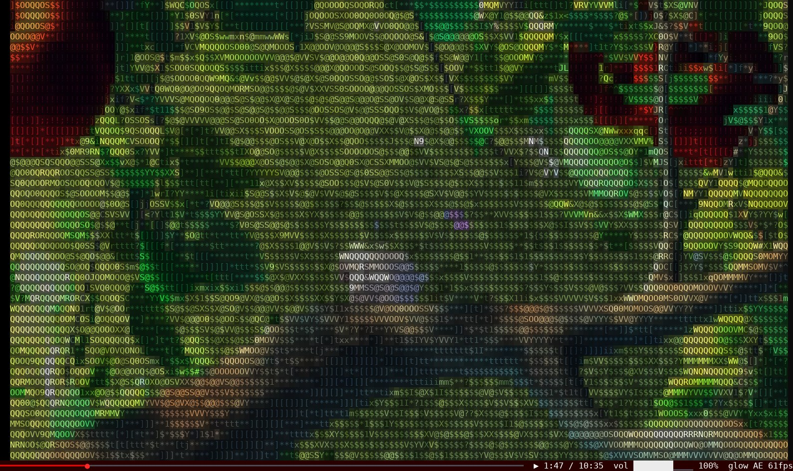
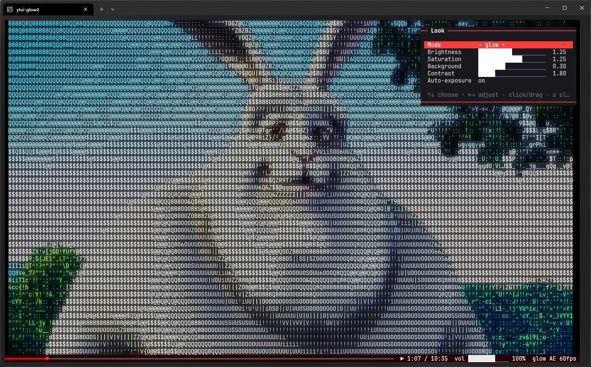

# ytui: YouTube in the terminal

**ytui** is a terminal YouTube client (TUI) for Windows, Linux and macOS. Search YouTube, browse
Home and Trending, and watch videos right in your terminal. Video plays as colour ASCII art, as
Unicode mosaics, or as real pixels with sixel and kitty graphics. On Windows Terminal it can also
play through a native GPU window. You don't need a browser or a YouTube API key. It's one small
Rust binary, with yt-dlp and libmpv doing the heavy lifting.

**[Download the latest release](https://github.com/bong-water-water-bong/ytui/releases/latest)** for Windows, Linux or macOS · **[Website and docs](https://bong-water-water-bong.github.io/ytui/)**


*Home, signed out: the Trending feed, with thumbnails drawn as pixel graphics.*


*Native GPU video window in Windows Terminal: hardware-decoded 1080p60, with ytui's player bar and volume slider underneath.*


*The same video drawn inside the terminal with sixel graphics, at about 30 fps.*


*Glow mode: shape-matched ASCII in boosted colour over a dimmed copy of the picture, fullscreen at 60 fps.*


*The look panel (`o`): mode, brightness, saturation, background, contrast and auto-exposure, kept between runs.*

<sub>Video screenshots show [Big Buck Bunny](https://peach.blender.org/), © Blender Foundation, licensed [CC BY 3.0](https://creativecommons.org/licenses/by/3.0/).</sub>

## Features

- **Watch YouTube in the terminal:** play videos as ASCII art, as Unicode mosaics (sextant, quadrant, half-block or braille), or in glow mode.
- **Real pixels:** sixel and the kitty graphics protocol (Windows Terminal, kitty, Ghostty, WezTerm, foot), also inside tmux.
- **Native video window on Windows Terminal:** GPU-decoded video up to 1080p60, kept over the player area.
- **60 fps playback through libmpv:** hardware decoding, instant seek and pause, and A/V sync. Without libmpv it falls back to ffmpeg.
- **YouTube's layout, in the terminal:** Home with Trending, Music, Gaming, News and more. Also search, channels, playlists, comments and live chat.
- **Optional Google sign-in:** your recommendations, subscriptions, playlists, likes and comments.
- **Captions, volume slider, autoplay, tabs and watch later.** Mouse and keyboard both work.
- **Runs over SSH:** a character render mode works in any truecolour terminal.

## Install

Download the package for your platform from the
**[latest release](https://github.com/bong-water-water-bong/ytui/releases/latest)**:

| Platform | Package |
|---|---|
| Windows 10/11 (x64) | `ytui-<version>-windows-x86_64.zip` (includes libmpv); run `ytui.exe` in Windows Terminal |
| Linux (x86_64) | `ytui-<version>-linux-x86_64.tar.gz` |
| macOS (Apple Silicon) | `ytui-<version>-macos-arm64.tar.gz` |

Then install the tools ytui uses:

- **Windows:** `winget install yt-dlp.yt-dlp Gyan.FFmpeg DenoLand.Deno`
- **macOS:** `brew install yt-dlp ffmpeg deno mpv`
- **Linux:** install `yt-dlp`, `ffmpeg`, Node.js 22+ or Deno, and `libmpv` (package `libmpv2` or `mpv-libs`) with your package manager.

Or build from source with `cargo build --release` (see [Build](#build)).

To remove ytui and everything it stored, run `ytui --uninstall`. It lists what it will delete and asks first.

## Requirements

- `yt-dlp` (plus Node.js 22+ or Deno, which yt-dlp needs for YouTube)
- `ffmpeg`
- a truecolour terminal; a font with Unicode sextants for `sextant` mode

- optional, recommended: **libmpv** (playback engine: captions, instant seek/pause, A/V sync,
  hardware decoding, and the native video window on Windows). Without it ytui plays through an
  ffmpeg pipe as before.

## Build

```
cargo build --release
```

### Windows

Runs natively in Windows Terminal (sixel graphics, WASAPI audio through libmpv).
Install `yt-dlp`, `ffmpeg` and `deno` (e.g. with winget), and put `libmpv-2.dll` from a
[shinchiro mpv-dev build](https://github.com/shinchiro/mpv-winbuild-cmake/releases) next to
`ytui.exe` or in `%LOCALAPPDATA%\libmpv\` (or point `YTUI_LIBMPV` at it). State lives in
`%USERPROFILE%\.local\share\ytui\`.

## Playback engine

With libmpv, mpv does demuxing, decoding (hardware where possible), A/V sync, audio output and
subtitles; frames come back through its software render API and go through ytui's renderers.
Seeks take ~0.1 s instead of restarting ffmpeg. `--engine mpv|ffmpeg` picks one explicitly.

**Native video window (Windows Terminal):** mpv renders straight to the GPU in a borderless
window that ytui keeps glued over the player area (inline, miniplayer and fullscreen), using the
terminal's exact grid geometry from UI Automation. It never takes focus, clicks go through to
ytui, and it hides when you switch tabs or open a dialog. `N` toggles it; `--no-native` disables it.

**Captions:** `S` cycles off / each caption track (uploaded first, then auto-generated); the
language you pick is remembered for later videos. In character modes they're drawn as text over
the video; with pixel graphics or the native window mpv renders them into the picture.

YouTube stalls open-ended HTTP range requests after ~800 KB, so ffmpeg and mpv read googlevideo
streams through a small local relay that fetches them in bounded chunks.

## Usage

```
ytui                         # opens Home
ytui lofi hip hop            # opens a search
ytui https://youtube.com/…   # opens a video, playlist or channel URL (also @handle)
ytui --mode sextant --audio pulse
ytui --import-subs subscriptions.csv   # Google Takeout export
ytui --snapshot SRC --at 30  # print one rendered frame
```

It works like a browser for YouTube:

- **Tabs** with back/forward history, and an **address bar** with live search suggestions
  that also takes URLs
- **Home**: "For you" built from your watch history and subscriptions, plus topic chips
- **Search** with filters (videos, shorts, channels, playlists, live, newest) and infinite scroll
- **Watch page**: inline player, description with clickable chapter timestamps, likes/views,
  comments with replies, "Up next" with autoplay, playlist queue
- **Live chat** on live streams and **chat replay** on past streams, synced to the playhead
  (also beside the video in fullscreen)
- **Volume control** (0–150%, mute), applied live without restarting playback
- **3D audio visualiser** (`V`) in place of the video, driven by the real audio, and a
  3D scene while videos load; `ytui --demo3d` shows the engine on its own
- **Miniplayer** when you scroll or browse away, with overlay controls (↗ back to the
  video, ✕ close, play/pause), and **fullscreen** (`f`)
- **Channel pages** (banner, avatar, Home/Videos/Shorts/Live/Playlists tabs) and **playlists**
- **Subscriptions, history (with resume positions) and watch later**, stored locally in
  `~/.local/share/ytui/`
- **Mouse**: click anything, wheel to scroll, click the progress bar to seek

- **Sign in** (optional) to like / dislike videos, comment and reply, send live chat
  messages, save videos to playlists and manage your playlists, and sync subscriptions with
  your YouTube account, using Google's official OAuth
  and the YouTube Data API (see below)

Browsing uses YouTube's own web JSON API directly (no API key, no account); `yt-dlp` is only used
to resolve stream URLs. Press `?` in the app for every key.

## Pixel graphics (kitty / sixel)

On terminals with a graphics protocol, ytui shows real pixels for video, thumbnails, avatars,
banners and the 3D scenes instead of characters. It asks the terminal at startup and picks:

- **kitty graphics protocol**: kitty, Ghostty (and kitty / Ghostty behind tmux). Images are
  sent zlib-compressed and drawn with Unicode placeholders, so they scroll and clip with the UI
  and work inside tmux (needs `set -g allow-passthrough on` in tmux). Consecutive video frames
  reuse the image and transmit only the changed row bands, which measured ~65% fewer bytes on a
  mostly-static scene and 0% on a hard cut (it falls back to a full frame whenever banding would
  cost more, so it is never worse).
- **sixel**: foot, WezTerm, xterm (`-ti vt340`), mlterm, Konsole, Windows Terminal and others.
  Adaptive palette per frame (median cut) with a light ordered dither. Some terminals report a bogus cell width
  (tmux's `client_cell_width` can be the glyph gap); the width is then rebuilt from the height's
  cell aspect rather than discarding sixel.
  Like kitty, consecutive video frames resend only the cell rows that changed (the whole frame
  when 80% or more did), drawn in the palette of the last whole frame so they match the rows left
  on screen. Rows are compared with what the screen shows, and compression noise is not a change:
  a row is resent when more than 2% of its pixels moved by over 12 levels, or any pixel by over
  48 (so typed text and cursors always go out). Measured on real clips at 960x270 px, 30 fps:
  lecture slides 27 -> 1 KB per frame, a screen recording 58 -> 9 KB, animation 260 -> 135 KB, a
  talking head 234 -> 117 KB, for 0-1.2 dB. `YTUI_SIXEL_EXACT=1` resends every changed row.
- otherwise the character renderers as before.

`G` switches between pixels and characters (saved). `--gfx auto|kitty|sixel|off` (or
`YTUI_GFX`) overrides detection. Pixel video is capped at 1920 px locally and at 960 px / 12 fps
over SSH to keep bandwidth around 4 MB/s; change with `--gfx-px N` and `--gfx-fps N`
(0 = unlimited).

## Colours under tmux

ytui draws in 24-bit colour. If tmux doesn't know the outer terminal supports it, tmux rounds
every colour to its 256-colour palette, which bands gradients and shifts hues. ytui detects this
and maps the picture to the 256 palette itself with ordered dithering, and the status bar says
how to get full colour: add

```
set -as terminal-features ',xterm*:RGB'
```

to `~/.tmux.conf` and reattach. `--colors auto|256|true` (or `YTUI_COLORS`) overrides.

## 3D ASCII engine

ytui includes a small real-time 3D software renderer whose output goes through the same
shape-matched glyph renderer as video: multi-threaded triangle rasterisation with a depth buffer,
sun / ambient / rim lighting, specular highlights, shadow mapping, fog, procedural grid-line
floors, and an ink-outline pass on depth and normal edges so silhouettes come out as crisp
strokes. For 3D it crushes darks (empty space stays empty) and takes glyph density from colour
value, so saturated objects still read as solid.

```
ytui --demo3d            # logo · press 1-4 for logo, knot, terrain, visualizer
ytui --demo3d terrain    # m cycles render mode, arrows orbit, +/- zoom, space pause
```

In the app, `V` swaps the video for a 3D audio visualiser (an FFT of the audio, which also works
with sound off), and a spinning 3D logo shows while a video loads. At 180×49 cells the engine
renders 1080×588 px in 9–14 ms per frame on a 16-thread CPU.

## Signing in (likes and comments)

Browsing needs no account. To like, dislike, comment and reply, sign in with Google's official
OAuth flow using your own free Google Cloud OAuth client. ytui never sees your password; tokens
are stored in `~/.local/share/ytui/oauth.json` (mode 0600).

1. In the [Google Cloud console](https://console.cloud.google.com/), create a project and enable
   **YouTube Data API v3** (APIs & Services → Library).
2. Google Auth Platform → Branding: set an app name and your email. Audience: **External**, and
   add your Google account under **Test users**.
3. Google Auth Platform → Clients → Create client → **Desktop app** → download the JSON.
4. Run `ytui --login --client ~/Downloads/client_secret_XXXX.json` and open the link it prints.
   On a remote/SSH session the final page won't load (it points at `127.0.0.1`); copy that page's
   address from the browser and paste it into the terminal.

Signed in, your YouTube subscriptions are synced at startup and on the Subscriptions page, and
Subscribe / Unsubscribe change them on YouTube. Channels you subscribed to in ytui before
signing in stay local until you press "Upload … to YouTube" there. Live chat gets a
"Say something…" box (or press `I`).

**Playlists**: `≡+ Save` on a video (or `P` on any focused video) opens *Save to…* with your
playlists ticked where the video already is; tick/untick to add/remove, or create a new one.
The **Playlists** page in the sidebar lists your playlists; each one has Play all, Rename,
Privacy (private → unlisted → public), Delete, and ↑ ↓ ✕ on every video. YouTube's own
"Watch later" isn't available through the API, so ytui's Watch later stays local.

While the OAuth app is in *Testing*, Google expires the sign-in after 7 days (run `ytui --login`
again, or publish the app). The free quota is 10,000 units/day; a like or comment costs 50.
`ytui --logout` revokes access. `ytui --help-login` prints these steps.

## Render modes (`m` cycles)

| Mode | Description |
|---|---|
| `glow` | Shape-matched ASCII in boosted colour over a dimmed copy of the picture; tune it in the look panel (`o`) |
| `art` | Clean ASCII art (default): stroke characters (`_ - | / \`) along edges, a short density ramp for tone, symbols where there is fine detail, coloured ink on black; characters hold steady between video frames instead of flickering |
| `ascii` | Two-tone shape-matched ASCII: flat areas are clean colour, glyphs only where there is edge detail |
| `classic` | Shape-matched ASCII, colour ink on a dark ground |
| `sextant` | 2×3 two-colour mosaic per cell (sharpest) |
| `quadrant` | 2×2 two-colour mosaic |
| `halfblock` | Top/bottom half blocks |
| `braille` | 2×4 dot mosaic. Each dot covers 3×3 px, so it cannot resolve detail finer than that — a 2px checkerboard averages to grey, correctly. Highest dot count of any mode; worst at hard black/white at the smallest scales. |
| `ansi` | Real text-mode art in 24-bit colour: CP437 glyphs from the IBM 8×16 ROM font, two colours per cell, the best two for the picture rather than the nearest of 16 |
| `ansi9` | As `ansi` at 9 dots per cell: the extra column makes block characters and box rules join without a seam, as a VGA screen drew them |
| `ansi-16` | The period-correct version: the 16-colour DOS palette with iCE colours (8 foregrounds × 16 backgrounds) |
| `ansi9-16` | `ansi-16` at 9 dots per cell |
| `ansiblink` | As `ansi-16`, but backgrounds limited to the 8 that do not blink (iCE off) |

The `ansi` modes are the slow ones — they fit every CP437 glyph for every cell. Real numbers, per
frame: about 33 ms at 80×24, 79 ms at 120×40, 165 ms at 200×50. So on a normal terminal they hold
~30 fps and are perfectly watchable; on a very large one they crawl, and ytui says so when you pick
one rather than letting the picture stutter silently. Truecolour is the *faster* of the two — with
the ink mask fixed, the best two colours are the two group means, so there is no palette search to
do. The mosaic modes remain the fluid choice at any size. See [ANSI art](#ansi-art) below.

**Auto-exposure** (on by default, `E` toggles) lifts under-exposed video so dark scenes stay
readable: it measures each frame's 1st–99th percentile brightness, raises the highlights to white
with one gain for all channels (hues hold), eases in over ~0.2 s and resets on seeks. Frames
whose highlights already reach white are left alone, and the gain is capped at 3.5× so fades to
black don't become noise. `AE` on the player bar shows when it's on.

The ASCII modes match glyph *shape*, not just brightness, following the technique in Alex Harri's
["ASCII characters are not pixels"](https://alexharri.com/blog/ascii-rendering): each glyph is
rasterised from a real monospace font and described by its ink coverage in six staggered sampling
circles; image cells are sampled the same way, with directional and global contrast enhancement,
and the nearest glyph wins.

## ANSI art

ytui speaks the format the BBS art scene has used since 1990: 80×25 text mode, code page 437, and
the 16-colour attribute byte.

```
ytui art.ans                             open art in the app
ytui --view-ans art.ans                  draw art straight to the terminal
ytui --snapshot-ans VIDEO -o art.ans     save a video frame as ANSI art
ytui --convert-ans art.ans -o out.ans    re-encode existing art
```

Options for the writer: `--palette` (write the 16-colour DOS version instead of 24-bit),
`--no-ice` (read the background high bit as blink, 8 backgrounds), `--compact` (CR/LF rows instead
of absolute cursor moves — smaller, but clients that wrap at column 80 will band it), and `--bits 9`
(the 9th-dot rule). 24-bit colour goes into the file as PabloDraw's `ESC[1;r;g;bt` sequences, written
*after* the palette escape so a viewer that ignores them still draws the right 16-colour picture.

The interesting details, all of which took a wrong turn first:

* **`ESC[1m` is not bold.** It sets the foreground's high bit, and it brightens the colour *already
  set*, not just the next one. Art writes a bare `ESC[1m` after a colour to make it bright, so
  treating it as a font weight leaves the whole picture a shade too dark.
* **`ESC[5m` is not blink.** It sets the background's high bit, and whether that is a colour at all
  depends on the iCE convention, which is a *reading* choice rather than something the file records.
* **The DOS and ANSI colour orders disagree.** Attribute 1 is blue, but `ESC[31m` is red.
* **Bright has to be spelled `ESC[1;3Xm`, not `ESC[9Xm`.** AnsiLove, the reference renderer,
  does not implement the 90–97 range at all.
* **A foreground escape must not start with `ESC[0m`** — that resets the background too.

The engine is conformance-tested against [AnsiLove/C](https://www.ansilove.org): its own
`bs-alove.ans` fixture renders **pixel for pixel identically** (604 160 pixels, zero differences),
and so does our re-encoding of it rendered by AnsiLove. Both tests ship in the repo.

## Keys

| Key | Action |
|---|---|
| `/` `Ctrl-L` | search or open a URL |
| arrows / `hjkl`, `Enter` | move focus, open |
| `H` / `L` | back / forward |
| `Ctrl-T` `Ctrl-W` `J` `K` | new tab, close tab, next / previous tab |
| `space` `f` | pause, fullscreen |
| `,` `.` / `<` `>` / `0`–`9` | seek 10 s / 60 s / jump |
| `+` `-` `M` | volume up / down, mute |
| `C` `I` | show / hide live chat, send a chat message |
| `P` | save the focused / current video to a playlist |
| `V` | 3D audio visualiser instead of the video |
| `E` | auto-exposure on / off |
| `S` | captions: off / each track |
| `N` | native GPU video window on / off (Windows) |
| `G` | pixel graphics (kitty / sixel) on / off |
| `n` `a` `x` | next video, autoplay toggle, close player |
| `w` `s` `c` `t` | watch later, subscribe, go to channel, open in new tab |
| composer | `Enter` post, `Alt-Enter` new line, `Esc` cancel (paste works) |
| `m` | cycle render mode |
| `o` | look panel: mode, brightness, saturation, background, contrast, auto-exposure |
| `?` `q` | help, quit |

With libmpv, audio goes through mpv's own output (WASAPI, PipeWire/PulseAudio, ALSA…).
Otherwise audio goes through PipeWire/PulseAudio (`pw-cat` or `pacat`) or ALSA (`aplay`), with ytui
applying the volume itself; without those tools ffmpeg plays audio directly. Pick the output
with `--audio`; it is off by default over SSH.

## License

MIT, see [LICENSE](LICENSE).
