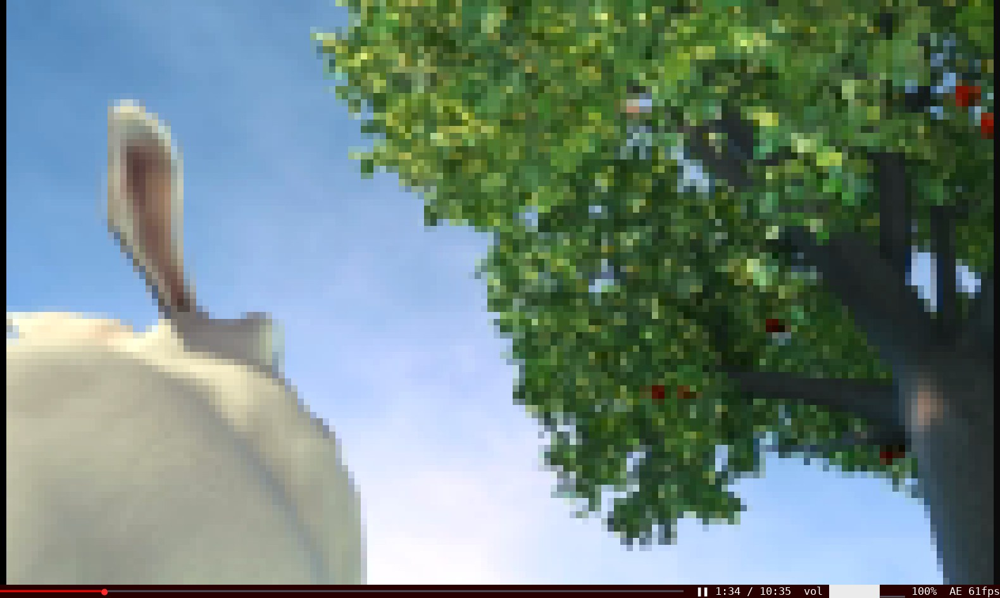
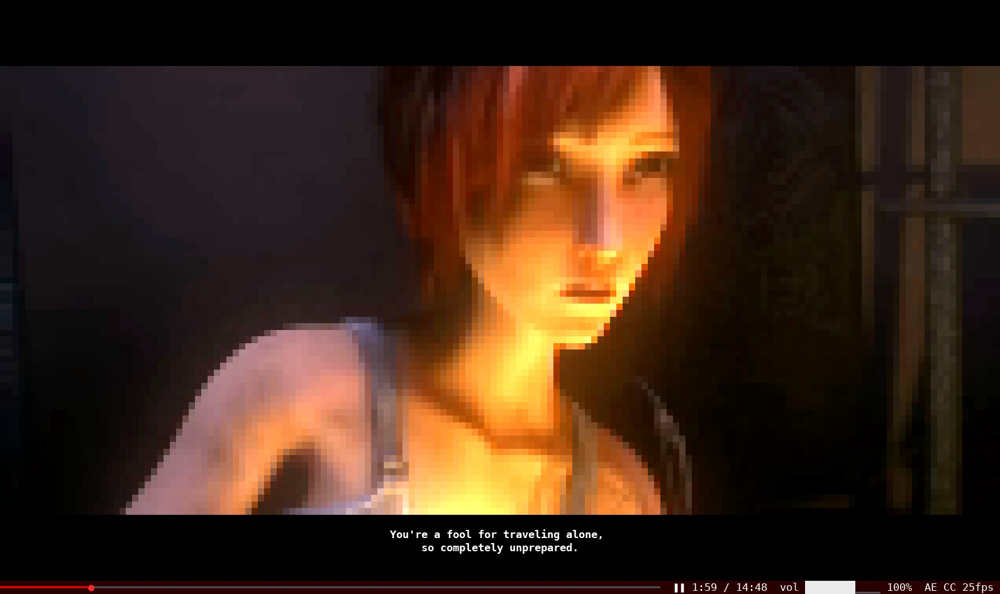
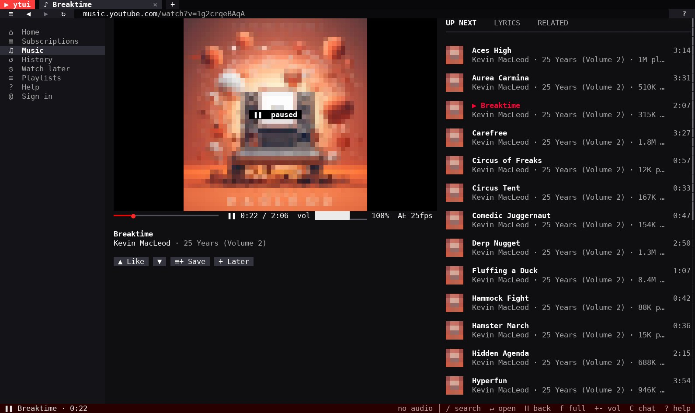

# ytui: YouTube in the terminal

**ytui** is a terminal YouTube client (TUI) for Windows, Linux and macOS. Search YouTube, browse
Home and Trending, and watch videos right in your terminal. Video is drawn as 24-bit colour
half blocks, at up to 60 fps. You don't need a browser or a YouTube API key. It's
one small Rust binary, with yt-dlp and ffmpeg doing the heavy lifting.

**[Download the latest release](https://github.com/bong-water-water-bong/ytui/releases/latest)** for Windows, Linux or macOS · **[Website and docs](https://bong-water-water-bong.github.io/ytui/)**


*Home, signed out: the Trending feed, with thumbnails drawn as half blocks.*


*Fullscreen and paused: each cell is a `▀` half block, two pixels in 24-bit colour.*


*Captions (`S`): bold white text in a solid black box, in your system language.*

<sub>The half-block screenshot shows [Big Buck Bunny](https://peach.blender.org/), © Blender Foundation, licensed [CC BY 3.0](https://creativecommons.org/licenses/by/3.0/). The captions screenshot shows [Sintel](https://durian.blender.org/), © Blender Foundation, licensed [CC BY 3.0](https://creativecommons.org/licenses/by/3.0/).</sub>

## Features

- **Watch YouTube in the terminal:** truecolour half blocks, sending only what changed, so playback stays smooth.
- **60 fps playback through ffmpeg:** streams up to 720p, the lowest height YouTube serves at 60 fps.
- **YouTube's layout, in the terminal:** Home with Trending, Music, Gaming, News and more. Also search, channels, playlists, comments and live chat.
- **YouTube Music:** the Music link opens music.youtube.com in ytui: Home, Explore, charts, moods and genres, search, artists, albums, your library, and a music player with a queue, lyrics and related songs.
- **Optional Google sign-in:** your recommendations, subscriptions, playlists, likes and comments.
- **Captions, volume slider, autoplay, tabs and watch later.** Mouse and keyboard both work.
- **Runs over SSH:** it works in any truecolour terminal.

## Install

Download the package for your platform from the
**[latest release](https://github.com/bong-water-water-bong/ytui/releases/latest)**:

| Platform | Package |
|---|---|
| Windows 10/11 (x64) | `ytui-<version>-windows-x86_64.zip`; run `ytui.exe` in Windows Terminal |
| Linux (x86_64) | `ytui-<version>-linux-x86_64.tar.gz` |
| macOS (Apple Silicon) | `ytui-<version>-macos-arm64.tar.gz` |

Each package holds `ytui` (or `ytui.exe`), `README.md` and `LICENSE`.

Then install the tools ytui uses:

- **Windows:** `winget install yt-dlp.yt-dlp Gyan.FFmpeg DenoLand.Deno`
- **macOS:** `brew install yt-dlp ffmpeg deno`
- **Linux:** install `yt-dlp`, `ffmpeg`, and Node.js 22+ or Deno with your package manager.

Or build from source with `cargo build --release` (see [Build](#build)).

To remove ytui and everything it stored, run `ytui --uninstall`. It lists what it will delete and asks first.

## Requirements

- `yt-dlp` (plus Node.js 22+ or Deno, which yt-dlp needs for YouTube)
- `ffmpeg`
- a truecolour terminal

## Build

```
cargo build --release
```

### Windows

Runs natively in Windows Terminal, with audio through `ffplay` (it comes with ffmpeg).
Install `yt-dlp`, `ffmpeg` and `deno` (e.g. with winget). State lives in
`%USERPROFILE%\.local\share\ytui\`.

## Playback

Every video plays through ffmpeg and is drawn in the terminal. ytui fetches streams up to 720p
by default, the lowest height YouTube serves at 60 fps; `--height N` changes that and `--fps N`
caps the frame rate.

**Captions:** the first press of `S` picks your system language (`LANG`), else English,
preferring the creator's captions over automatic ones; further presses go through each track, then
off. The language you pick is remembered for later videos. ytui fetches the track's WebVTT file
itself and draws each cue as bold white text in a solid black box, with a blank row above and
below.

YouTube stalls open-ended HTTP range requests after ~800 KB, so ffmpeg reads googlevideo
streams through a small local relay that fetches them in bounded chunks.

## Usage

```
ytui                         # opens Home
ytui lofi hip hop            # opens a search
ytui https://youtube.com/…   # opens a video, playlist or channel URL (also @handle)
ytui --fullscreen --audio pulse
ytui --import-subs subscriptions.csv   # Google Takeout export
ytui --snapshot SRC --at 30  # print one rendered frame
```

It works like a browser for YouTube:

- **Tabs** with back/forward history, and an **address bar** with live search suggestions
  that also takes URLs
- **Home**: "For you" built from your watch history and subscriptions, plus topic chips
- **Search** with filters (videos, shorts, channels, playlists, live, newest) and infinite scroll
- **Watch page**: inline player, description with clickable chapter timestamps, likes/views,
  comments with replies, "Up next" with autoplay, playlist queue
- **Live chat** on live streams and **chat replay** on past streams, synced to the playhead
  (also beside the video in fullscreen)
- **Volume control** (0–150%, mute), applied live without restarting playback
- **Miniplayer** when you scroll or browse away, with overlay controls (↗ back to the
  video, ✕ close, play/pause), and **fullscreen** (`f`)
- **Channel pages** (banner, avatar, Home/Videos/Shorts/Live/Playlists tabs) and **playlists**
- **Subscriptions, history (with resume positions) and watch later**, stored locally in
  `~/.local/share/ytui/`
- **Mouse**: click anything, wheel to scroll, click the progress bar to seek

- **Sign in** (optional) to like / dislike videos, comment and reply, send live chat
  messages, save videos to playlists and manage your playlists, and sync subscriptions with
  your YouTube account, using Google's official OAuth
  and the YouTube Data API (see below)

Browsing uses YouTube's own web JSON API directly (no API key, no account); `yt-dlp` is only used
to resolve stream URLs. Press `?` in the app for every key.

## YouTube Music

**♫ Music** in the sidebar opens [YouTube Music](https://music.youtube.com/) in ytui. You get its
Home, Explore (new releases, charts, moods and genres), search with Songs, Videos, Albums, Artists
and Playlists, artist, album and playlist pages, and your Library when signed in. Songs play in a
music player with Up next, Lyrics and Related tabs. A song from an album or playlist plays through
that list; anywhere else it starts a radio. music.youtube.com links open there too.
[More about YouTube Music in ytui](https://bong-water-water-bong.github.io/ytui/guide/youtube-music/).


<sub>Shows *25 Years (Volume 2)* by [Kevin MacLeod](https://incompetech.com/), licensed [CC BY 4.0](https://creativecommons.org/licenses/by/4.0/).</sub>

## Colours under tmux

ytui only draws in 24-bit colour. If tmux doesn't know the outer terminal supports it, tmux rounds
every colour to its 256-colour palette, which bands gradients and shifts hues. ytui detects this
and shows a hint: add

```
set -as terminal-features ',xterm*:RGB'
```

to `~/.tmux.conf` and reattach.

## Signing in (likes and comments)

Browsing needs no account. To like, dislike, comment and reply, sign in with Google's official
OAuth flow using your own free Google Cloud OAuth client. ytui never sees your password; tokens
are stored in `~/.local/share/ytui/oauth.json` (mode 0600).

1. In the [Google Cloud console](https://console.cloud.google.com/), create a project and enable
   **YouTube Data API v3** (APIs & Services → Library).
2. Google Auth Platform → Branding: set an app name and your email. Audience: **External**, and
   add your Google account under **Test users**.
3. Google Auth Platform → Clients → Create client → **Desktop app** → download the JSON.
4. Run `ytui --login --client ~/Downloads/client_secret_XXXX.json` and open the link it prints.
   On a remote/SSH session the final page won't load (it points at `127.0.0.1`); copy that page's
   address from the browser and paste it into the terminal.

Signed in, your YouTube subscriptions are synced at startup and on the Subscriptions page, and
Subscribe / Unsubscribe change them on YouTube. Channels you subscribed to in ytui before
signing in stay local until you press "Upload … to YouTube" there. Live chat gets a
"Say something…" box (or press `I`).

**Playlists**: `≡+ Save` on a video (or `P` on any focused video) opens *Save to…* with your
playlists ticked where the video already is; tick/untick to add/remove, or create a new one.
The **Playlists** page in the sidebar lists your playlists; each one has Play all, Rename,
Privacy (private → unlisted → public), Delete, and ↑ ↓ ✕ on every video. YouTube's own
"Watch later" isn't available through the API, so ytui's Watch later stays local.

While the OAuth app is in *Testing*, Google expires the sign-in after 7 days (run `ytui --login`
again, or publish the app). The free quota is 10,000 units/day; a like or comment costs 50.
`ytui --logout` revokes access. `ytui --help-login` prints these steps.

## How video is drawn

Each cell is a `▀` half block: the top pixel is the foreground colour and the bottom pixel the
background, so a cell holds 1×2 pixels in 24-bit colour. ffmpeg decodes each frame at exactly the
cell grid (`cols × 2*rows` pixels). Thumbnails, avatars and banners are drawn the same way.

**Why it's smooth:** the frame rate is limited by how many bytes the terminal can parse, not by
drawing. ytui sends only cells that changed, and a cell keeps its colour until the picture there
moves past a small tolerance. Each frame is sized to a byte budget from the terminal's measured
speed: after each big frame ytui asks the terminal for the cursor position, which it can only
answer once it has processed the frame, and until it answers, newer frames replace the waiting one
instead of queueing. Still or slow pictures are sent exactly; fast motion gets slightly coarser
instead of dropping frames. A maximized GNOME Ptyxis (VTE) window holds 54–62 fps on 60 fps video.

**Auto-exposure** (on by default, `E` toggles) lifts under-exposed video so dark scenes stay
readable: it measures each frame's 1st–99th percentile brightness, raises the highlights to white
with one gain for all channels (hues hold), eases in over ~0.2 s and resets on seeks. Frames
whose highlights already reach white are left alone, and the gain is capped at 3.5× so fades to
black don't become noise. `AE` on the player bar shows when it's on.

## Keys

| Key | Action |
|---|---|
| `/` `Ctrl-L` | search or open a URL |
| arrows / `hjkl`, `Enter` | move focus, open |
| `H` / `L` | back / forward |
| `Ctrl-T` `Ctrl-W` `J` `K` | new tab, close tab, next / previous tab |
| `space` `f` | pause, fullscreen |
| `,` `.` / `<` `>` / `0`–`9` | seek 10 s / 60 s / jump |
| `+` `-` `M` | volume up / down, mute |
| `C` `I` | show / hide live chat, send a chat message |
| `P` | save the focused / current video to a playlist |
| `E` | auto-exposure on / off |
| `S` | captions: your language first, then each track, then off |
| `n` `a` `x` | next video, autoplay toggle, close player |
| `w` `s` `c` `t` | watch later, subscribe, go to channel, open in new tab |
| composer | `Enter` post, `Alt-Enter` new line, `Esc` cancel (paste works) |
| `?` `q` | help, quit |

Audio goes through PipeWire/PulseAudio (`pw-cat` or `pacat`) or ALSA (`aplay`), or through
`ffplay` on Windows, with ytui applying the volume itself. On Linux and macOS without those
tools, ffmpeg plays the audio directly. Pick the output with `--audio`; it is off by default over
SSH.

## License

MIT, see [LICENSE](LICENSE).
